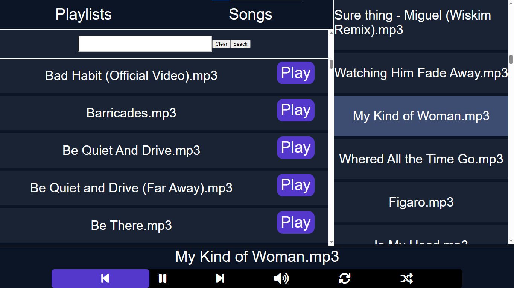

# Music streaming platform

### Description

This project was created to try and bypass all the ads that I would get when I listened to my favorite tunes. But I wanted to make it better. With Youtube Music on your phone you cannot close your phone to continue to listen to the music. 

Using the Javascript Audio API the website is able to play any audio through the browser. With a whole library of songs I could make a music platform that you'd see on Spotify and Youtube Music. 

Features a list of all the songs that can be clicked on to then be loaded and played. The song gets tracked to update a bar at the bottom of the page where all the controls are. They allow you to pause, play, skip song, adjust the volume, keep the song on repeat and shuffle playlist. 

The playlists feature is a pre-determined set of songs that can all be loaded together. The shuffle will then only play songs within that set. 

Best feature is that the website can be closed and the song will still continue to play. The songs automatically play the next song when the last is finished meaning it's total hands free music listening completely ad free

### Usage 

Visit the website https://jan-spalding.github.io/music/ to view

### Acknowledgements 

I don't own any of the songs.
